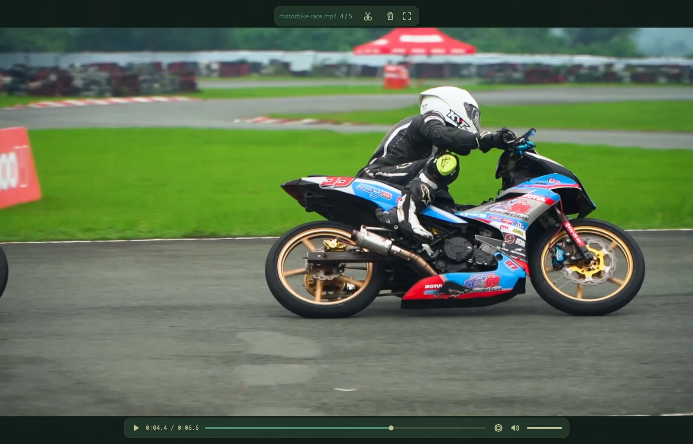
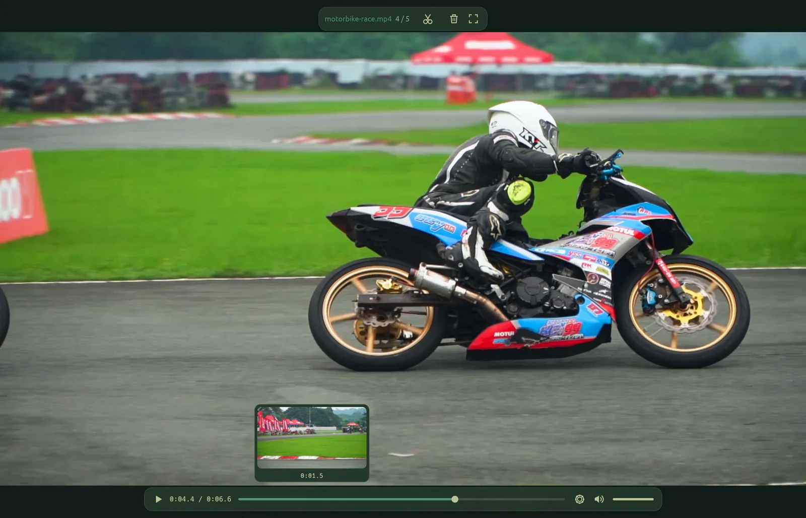
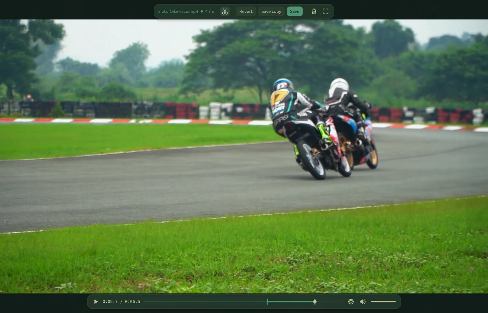
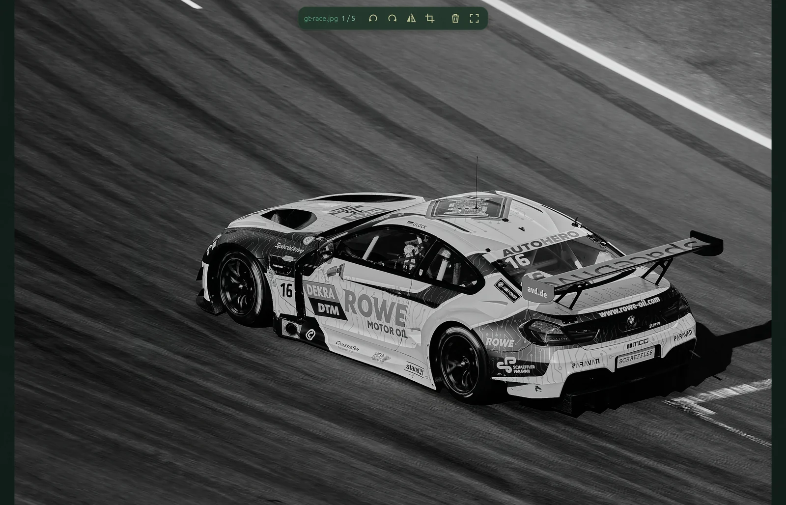
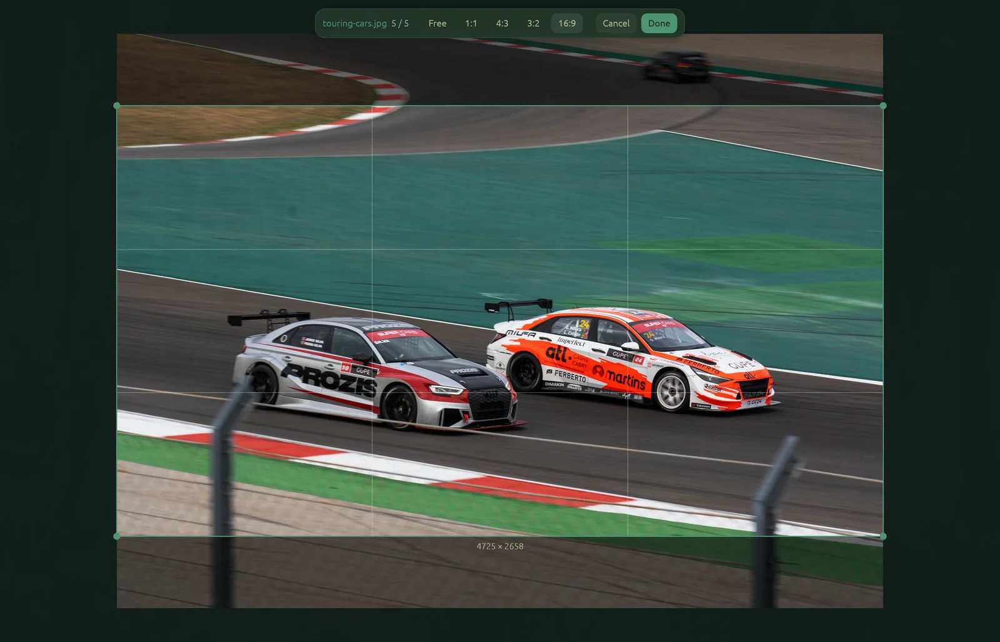

<p align="center">
  
</p>

<h1 align="center">anyview</h1>

<p align="center">
  <strong>One fast viewer for your photos, camera RAW files and videos on Linux.</strong>
</p>

<p align="center">
  <a href="LICENSE"></a>
  
</p>



<table>
  <tr>
    <td></td>
    <td></td>
  </tr>
  <tr>
    <td></td>
    <td></td>
  </tr>
</table>

## Features

- **Photos and camera RAW:** open JPEG, PNG, WebP and RAW files from most cameras.
- **Smooth video:** play and scrub even 4K video without slowing your computer down.
- **Trim clips:** cut a video to the exact frame you choose, with no loss in quality.
- **Quick edits:** crop, rotate and flip photos, then save or keep a copy.
- **Browse a folder:** step through every photo and video with the arrow keys.
- **Fits your desktop:** follows your Omarchy theme, and shows RAW thumbnails in your file
  manager.

## Install

anyview runs on Linux. On Arch, install the build tools, then build and install:

```sh
sudo pacman -S --needed git rust meson ninja nasm libva x264 x265
git clone https://github.com/mmzim05/anyview
cd anyview
./scripts/build-ffmpeg.sh
cargo build --release
sudo ./scripts/install.sh
```

For smooth video, install your graphics driver's video package: `intel-media-driver` for
Intel, `libva-mesa-driver` for AMD.

## Usage

Open a photo or video from your file manager with anyview, or run `anyview <file-or-folder>`.
The controls fade away when you are not using them, and come back when you move the mouse.

Press `?` or click the **?** button to see the keyboard shortcuts.

**Saving edits:** `Ctrl+S` saves over the file and moves the original to the trash.
`Ctrl+Shift+S` saves a copy next to it. `Ctrl+Z` undoes your edits. RAW files are never
overwritten; they save as a JPEG copy.

## Supported files

- **Photos:** JPEG, PNG, WebP, GIF, TIFF, BMP
- **Camera RAW:** Canon, Nikon, Sony, Fujifilm, Olympus, Panasonic, Pentax, Samsung, Leica
  and other DNG, Phase One, Kodak, Epson, Minolta. Hasselblad (`.3fr`) and Leaf (`.mos`) do
  not open yet.
- **Video:** MP4, MOV, MKV, WebM, AVI, MPEG-TS, MPG, FLV, OGV, WMV, 3GP

## Build from source

For development, run against the system FFmpeg without the build script:

```sh
FFMPEG_DIR=/usr cargo run --no-default-features -- <file-or-folder>
```

## License

[GPL-3.0-or-later](LICENSE)

Screenshot media from [Pexels](https://www.pexels.com/): photos by Philipp Fahlbusch and Telmo
Antunes, and a motorbike race video.
